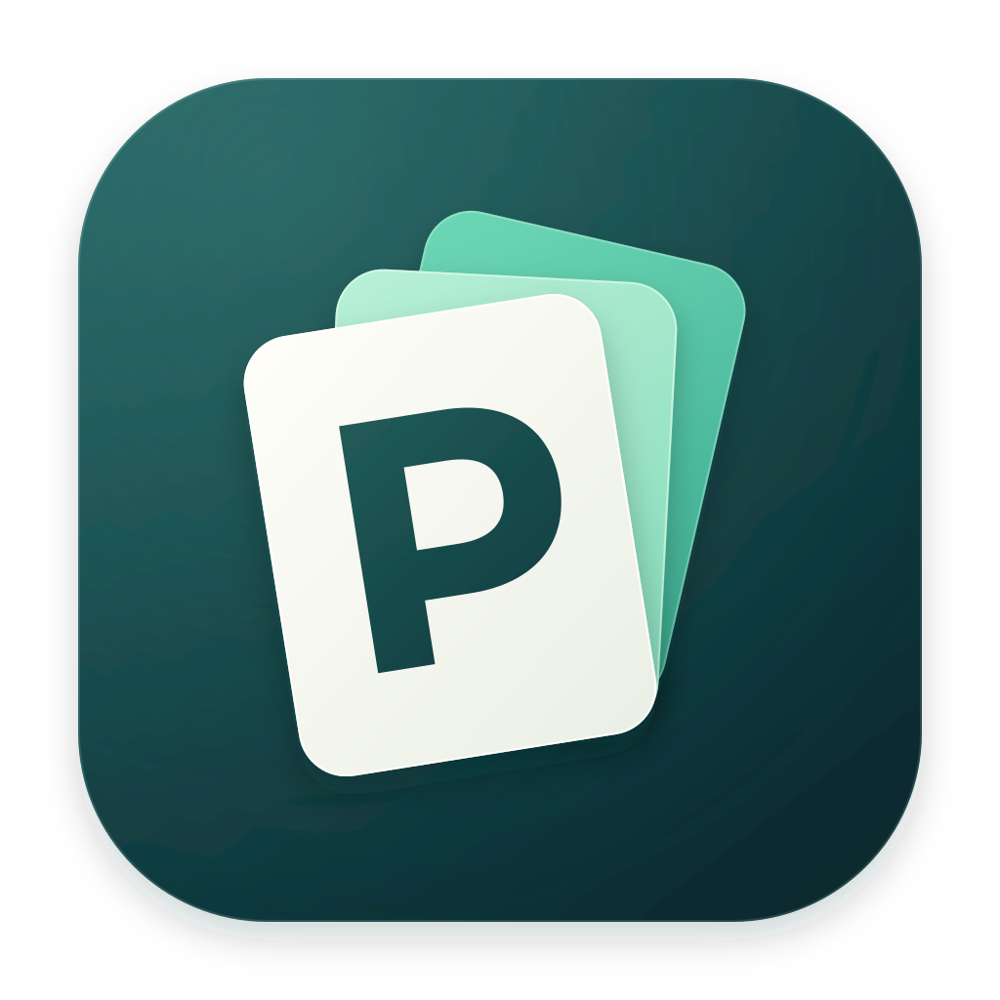
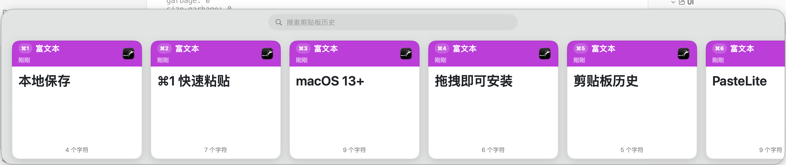
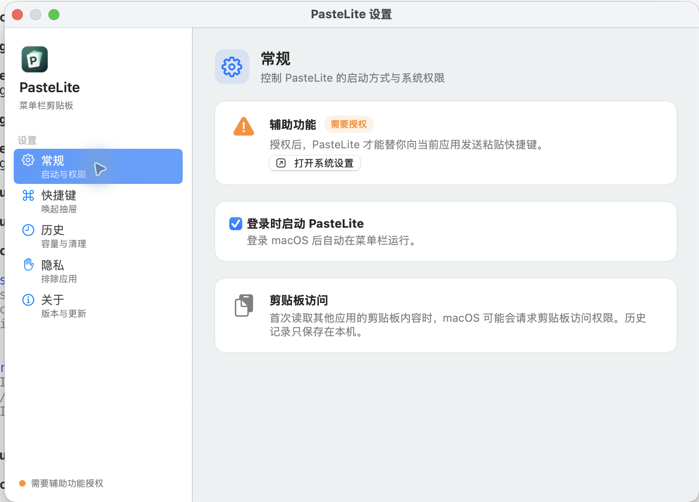
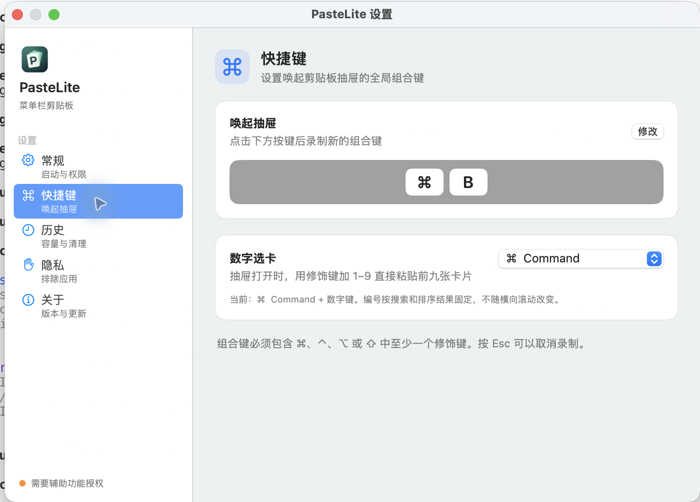
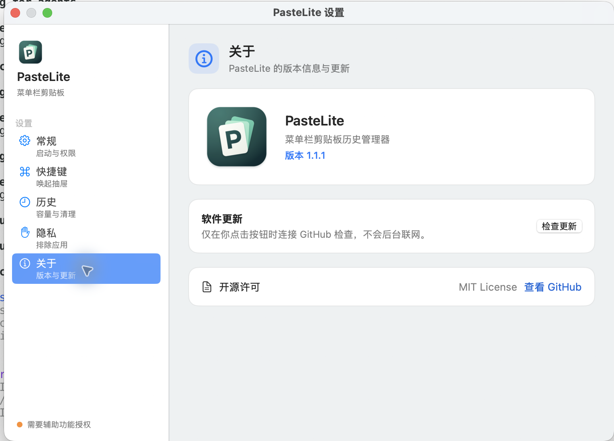

# PasteLite

<p align="center">
  
</p>

PasteLite 是一个原生 macOS 菜单栏剪贴板历史管理器，记录你复制过的内容，并通过全局快捷键快速搜索、预览和粘贴。它使用 SwiftUI、AppKit 和 Carbon 构建，不依赖第三方库，历史数据只保存在本机。

## 界面预览

剪贴板抽屉支持文本、富文本、来源应用图标、置顶、删除和 `⌘1–⌘9` 数字选卡：



### 设置界面

常规页集中管理辅助功能授权、登录时启动和剪贴板访问：



快捷键页可以修改抽屉唤起键，并选择数字选卡使用的修饰键：



关于页显示当前版本、应用图标、开源许可，并提供手动检查更新入口：



## 功能

- 每 0.5 秒监听系统剪贴板变化，支持文本、富文本、HTML、图片和文件。
- 默认使用 `⌘⇧V` 从鼠标所在屏幕底部打开毛玻璃抽屉。
- 搜索历史、置顶条目、删除条目，并在复制相同内容时去重置顶。
- 点击卡片即可回填剪贴板并尝试粘贴到原前台应用；未授予辅助功能权限时降级为仅回填剪贴板。
- 记录来源应用，可排除 1Password、KeePassXC 和钥匙串访问等密码管理器。
- 历史保存到本地，默认保留 100 条，可在设置中调整为 50–1000 条。
- 支持登录时启动，跟随系统浅色/深色模式。
- 设置中提供关于页、当前版本和手动检查更新，更新包下载后可替换旧版本。
- 抽屉打开时支持可配置修饰键 + 1–9 快速粘贴对应历史卡片。

## 系统要求

| 项目 | 支持范围 |
| --- | --- |
| macOS | macOS 13 Ventura 及以上 |
| CPU | Apple Silicon 和 Intel（Universal 二进制） |
| 分发方式 | 未上架 Mac App Store；Release 使用 ad-hoc 签名 |

## 安装

1. 从 [Releases](https://github.com/dzLin1820372845/PasteLite/releases) 下载最新的 `PasteLite-*-macOS-universal.dmg`。
2. 打开 DMG，将 `PasteLite.app` 拖到 `Applications` 文件夹。

> **首次启动提示**：PasteLite 当前使用未公证的 ad-hoc 签名。第一次启动如果 macOS 显示“Apple 无法验证 PasteLite 是否包含可能危害 Mac 安全或泄漏隐私的恶意软件”，请按下面步骤操作：
>
> 1. 在 Finder 中打开 DMG，把 `PasteLite.app` 拖到“应用程序”。
> 2. 右键 `PasteLite.app`，选择“打开”。
> 3. 如果仍被阻止，进入“系统设置 → 隐私与安全性”，点击“仍要打开”。

请只保留一个 PasteLite 副本并从“应用程序”启动。由于当前版本使用 ad-hoc 签名，更新二进制后 macOS 可能会把它视为新的授权对象，需要重新授予“辅助功能”权限。

3. 根据提示在“系统设置 → 隐私与安全性”中授予：
   - **辅助功能**：用于把选中的历史内容发送到当前前台应用。
   - **剪贴板访问**（macOS 15 及以上可能显示）：用于读取复制内容并保存历史。

应用启动后只显示在菜单栏，不显示 Dock 图标。默认按 `⌘⇧V` 打开历史抽屉，点击菜单栏图标也可以打开。

### 卸载

退出 PasteLite 后，将 `/Applications/PasteLite.app` 移到废纸篓。历史数据位于 `~/Library/Application Support/PasteLite/`，如需彻底清理请一并删除该目录。

## 隐私与限制

- 剪贴板历史、图片和富文本附件都保存在本机，不上传云端，也没有网络同步功能。
- 合成 `⌘V` 需要辅助功能权限；密码框等安全输入场景可能被 macOS 拦截，此时请手动粘贴。
- 来源应用是复制时刻前台应用的近似判断，后台菜单复制可能显示不同来源。
- Release 未经过 Apple 公证，换机器安装时可能需要右键“打开”。

## 从源码构建

构建需要完整 Xcode，脚本默认使用 `/Applications/Xcode.app`。当前项目使用 SwiftPM，最低部署目标为 macOS 13。

```bash
git clone https://github.com/dzLin1820372845/PasteLite.git
cd PasteLite
./build.sh
```

构建完成后：

- 应用：`build/PasteLite.app`
- Universal DMG：`dist/PasteLite-1.1.1-macOS-universal.dmg`

脚本会分别构建 `arm64` 和 `x86_64`，用 `lipo` 合并为 Universal 二进制，再组装并 ad-hoc 签名应用，最后生成可拖拽安装的 DMG。

## 数据位置

- 剪贴板历史：`~/Library/Application Support/PasteLite/`
- 设置：macOS `UserDefaults`（应用标识 `com.tclx.pastelite`）

## 版本

当前 Release 为 **1.1.1**，版本号遵循语义化版本格式（`MAJOR.MINOR.PATCH`）。后续版本会同步更新 `Info.plist`、Release 标签和安装包文件名。

## 许可证

PasteLite 使用 [MIT License](LICENSE) 开源。你可以自由使用、修改和分发，但需要保留许可证与版权声明。
